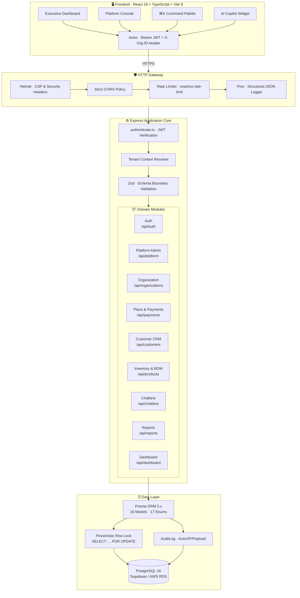
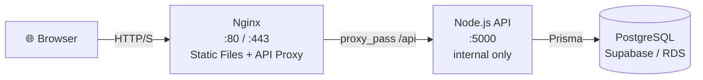
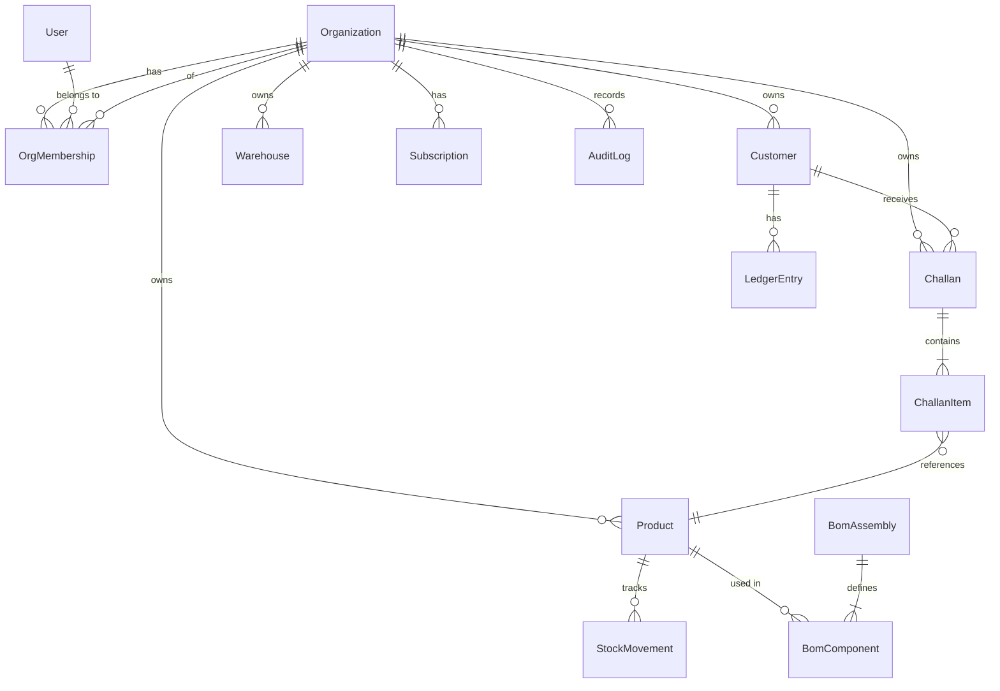

# ⚡ StockPulse — Enterprise Multi-Tenant B2B Operations Platform

<div align="center">


[](https://www.typescriptlang.org/)
[](https://react.dev/)
[](https://nodejs.org/)
[](https://expressjs.com/)
[](https://www.prisma.io/)
[](https://www.postgresql.org/)
[](https://vitejs.dev/)
[](https://docs.docker.com/compose/)
[](LICENSE)
[](.github/workflows)

**A production-grade, multi-tenant B2B SaaS platform unifying CRM, multi-warehouse inventory, BOM assemblies, statutory GST challans (Rule 55), customer financial ledgers, and platform super-admin governance — all in a single modular monolith.**

[Overview](#-executive-overview) · [Architecture](#-system-architecture) · [Features](#-key-capabilities) · [Tech Stack](#-technology-stack) · [Quick Start](#-quick-start-guide) · [RBAC](#-roles--permissions-matrix) · [API Reference](#-api-endpoints-reference) · [Testing](#-testing) · [Docker](#-docker-deployment) · [License](#-license)

</div>

---

## 📌 Executive Overview

**StockPulse** is engineered to eliminate operational friction across sales, warehousing, finance, and platform administration in multi-tenant B2B organizations.

Built on a clean **Modular Monolith** architecture with strict per-tenant data isolation. Every database query is scoped by `organizationId`, enforced through foreign-key constraints and indexed columns, ensuring complete data segregation between tenants without the distributed-systems overhead of microservices.

### Why StockPulse?

| Problem | StockPulse Solution |
|:---|:---|
| Scattered tools for CRM, warehouse, billing | Single unified platform per tenant |
| Multi-tenant data leaks | `organizationId`-scoped queries on every table |
| Race conditions on stock deductions | Pessimistic row locks (`SELECT ... FOR UPDATE`) in ACID transactions |
| Manual GST compliance | Automated CGST/SGST/IGST split with statutory challan generation |
| No visibility across tenants | Platform Super Admin command center with impersonation |
| Complex subscription management | Tiered plans with quota enforcement and UTR payment flows |

---

## 🏗️ System Architecture

StockPulse uses a **Modular Monolith** — clean domain boundaries without distributed-system complexity. All modules share a single Prisma client and database connection pool.



### Deployment Topology



---

## 🚀 Key Capabilities

### 1. Multi-Tenant Architecture & Commercial Entitlements
- **Strict Tenant Isolation** — every query scoped by `organizationId`; foreign-key cascades and unique composite indexes prevent cross-tenant data access
- **Tiered Subscription Plans** — Starter, Growth Pro, and Enterprise tiers with enforced quotas for `maxUsers`, `maxProducts`, `maxCustomers`, `maxWarehouses`, and `maxTransactions`
- **Billing Workflows** — manual UPI QR payment with UTR reference audit trail; automated subscription state transitions (`TRIAL → ACTIVE → SUSPENDED → CANCELLED`)
- **Plan Quota Enforcement** — every resource creation validates live usage against the tenant's active plan limits before committing

### 2. Platform Super Admin Command Center
- **Enterprise Tenant Hub** — monitor subscriptions, plan allocations, and tenant health; toggle lifecycle statuses
- **User Registry** — unified identity management to inspect, provision, and remove Organization Administrators
- **Organization Inspector Modal** — click any tenant to deep-dive into members, teams, credentials, commercial usage, and recent activity
- **Support Session Impersonation** — time-bounded, cryptographically signed sessions allowing Super Admins to debug tenant accounts; floating live banner with full audit logging

### 3. Statutory GST Delivery Challans (Rule 55)
- **Sequential Challan Numbers** — auto-generated, tenant-scoped sequential delivery challan IDs
- **Automated Tax Splits** — GSTIN state-code extraction drives automatic CGST+SGST (intra-state) vs IGST (inter-state) calculation
- **Credit Limit Enforcement** — credit utilization check blocks dispatch for over-limit customers before stock is touched
- **Pessimistic Concurrency Locking** — `SELECT ... FOR UPDATE` row locks inside a single ACID transaction prevent double-dispatch race conditions at high throughput
- **Immutable Line-Item Snapshots** — historical price, SKU name, and tax rates captured at confirmation time; future catalog edits never alter past records
- **Draft → Confirmed → Cancelled** — three-state machine with stock deduction occurring only on `CONFIRMED`

### 4. Inventory Intelligence & Supply Chain
- **Multi-Warehouse Location Tracking** — products assigned to warehouses with per-location stock levels
- **Concurrency-Safe Stock Deduction** — row-locked transactions prevent over-allocation even under parallel requests
- **BOM Production Assemblies** — multi-component Bill of Materials recipes; one-click assembly decrements components and increments finished-good stock atomically
- **Stock Adjustments with Audit Trail** — manual IN/OUT movements with reason codes and full actor/timestamp recording
- **Cycle-Count Stock Takes** — digital physical count tool to identify variance and generate reconciliation adjustments
- **Reorder Warning Engine & Multi-Filter Toolbar** — filter catalog items, stock movements, and challans by date presets (`Today`, `Past 7 Days`, `Past 30 Days`), recency ordering (`Newest First`), and material categories

### 5. Customer CRM & Financial Ledger 360°
- **Lead-to-Account Lifecycle** — leads progress to accounts; follow-up scheduling with timestamps
- **GSTIN Validation** — format validation and state-code resolution for every customer
- **Double-Entry Financial Ledger** — `SALE`, `PAYMENT`, `CREDIT_NOTE`, and `DEBIT_NOTE` transactions with running balance history
- **Credit Limit Monitoring** — real-time utilization prevents dispatch approval for over-limit accounts
- **Customer Risk Scoring** — derived from ledger balance, outstanding challans, and payment history

### 6. Bulk Data Ingestion & Product Import Engine
- **Excel (.xlsx) & CSV Import Modal** — automated client-side file parsing with standardized template download
- **Validation & Duplicate Handling** — pre-flight grid preview with configurable duplicate SKU strategies (`SKIP`, `OVERWRITE`, `FAIL`)
- **Role-Gated Batch Processing** — restricted to Warehouse and Organization Admin roles for data integrity

### 7. Notification History & Role Event Audit Feed (`/notifications`)
- **Server-Side Filtered Notifications** — paginated query engine supporting search, severity levels (`CRITICAL`, `WARNING`, `INFO`, `SUCCESS`), event types (`STOCK_LOW`, `CHALLAN_PENDING`, `REORDER_RECOMMENDED`, `ASSEMBLY_READY`, `CREDIT_RISK_ALERT`), date presets, and recency ordering
- **Dual View Modes** — switch between interactive Timeline Feed View and compact Structured Audit Table View
- **Smart Business Operational Analysis Engine** — high-contrast detail modal offering contextual event overviews, inventory impact statements, and role-specific action recommendations

### 8. Role-Tailored DOST AI Business Companion Widget
- **Role-Scoped Assistance** — dynamically adapts greetings, permission boundaries, and suggested prompts based on active role (`ORG_ADMIN`, `WAREHOUSE`, `SALES`, `ACCOUNTS`, `SUPER_ADMIN`)
- **Live Telemetry Inspection** — fetches real-time workspace statistics (`dashboardService.getStats()`) to highlight low stock alerts and pending draft dispatches upon opening
- **Real Action Execution (No Mocks)** — interactive confirmation cards for real live backend actions (`MOVE_STOCK`, `CREATE_CHALLAN`, `CREATE_CUSTOMER`, `BUILD_BOM_ASSEMBLY`, `UPDATE_ORG_STATUS`)

---

## 📊 Roles & Permissions Matrix

StockPulse uses a capability-based RBAC system. Each role maps to a granular set of permission codes evaluated by the `authorize` middleware on every request.

| Domain / Resource | `SUPER_ADMIN` | `ORG_ADMIN` | `SALES` | `WAREHOUSE` | `ACCOUNTS` |
|:---|:---:|:---:|:---:|:---:|:---:|
| **Platform Console & Tenants** | ⚡ Full | 🚫 None | 🚫 None | 🚫 None | 🚫 None |
| **Plan Matrix & UTR Approvals** | ⚡ Full | 🚫 None | 🚫 None | 🚫 None | 🚫 None |
| **Support Impersonation** | ⚡ Full | 🚫 None | 🚫 None | 🚫 None | 🚫 None |
| **Org Settings & Team Members** | ⚡ Platform | ✏️ Full CRUD | 👁️ Read | 👁️ Read | 👁️ Read |
| **Customer CRM & Ledgers** | ⚡ Platform | ✏️ Full CRUD | ✏️ Full CRUD | 🚫 None | 👁️ Read |
| **Product Catalog & Stock** | ⚡ Platform | ✏️ Full CRUD | 👁️ Read | ✏️ Full CRUD | 👁️ Read |
| **Stock Adjustments (IN/OUT)** | ⚡ Platform | ✏️ Create/Audit | 🚫 None | ✏️ Create/Audit | 🚫 None |
| **BOM Production Assemblies** | ⚡ Platform | ✏️ Full CRUD | 🚫 None | ✏️ Full CRUD | 🚫 None |
| **Delivery Challans (Rule 55)** | ⚡ Platform | ✏️ Full CRUD | ✏️ Full CRUD | 👁️ Read | 👁️ Read |
| **Reports & Analytics** | ⚡ Platform | 👁️ All KPIs | 👁️ Sales KPIs | 👁️ Stock KPIs | 👁️ Financials |
| **Org Billing & Subscriptions** | ⚡ Platform | ✏️ Manage | 🚫 None | 🚫 None | ✏️ Manage |
| **Audit Log** | ⚡ Platform | 👁️ Read | 🚫 None | 🚫 None | 🚫 None |

---

## 🛠️ Technology Stack

### Backend

| Layer | Technology | Purpose |
|:---|:---|:---|
| Runtime | **Node.js 20 LTS** | JavaScript server runtime |
| Framework | **Express.js 4.x** | HTTP routing and middleware pipeline |
| ORM | **Prisma 5.x** | Type-safe PostgreSQL access, migrations |
| Database | **PostgreSQL 16** | Primary relational store (Supabase / AWS RDS) |
| Validation | **Zod 3.x** | Runtime schema parsing and boundary enforcement |
| Auth | **jsonwebtoken 9.x** | JWT issuance and verification |
| Password | **bcrypt 6.x** | Salted password hashing (cost factor 10) |
| Logging | **Pino 10.x + pino-http** | Structured JSON production logging |
| Security | **Helmet 8.x + CORS** | CSP headers, CORS policy enforcement |
| Rate Limiting | **express-rate-limit 8.x** | Token-bucket IP-based rate limiting |
| Testing | **Jest 30 + Supertest 7** | Unit and HTTP integration test suite |
| Linting | **ESLint + TypeScript-ESLint** | Static analysis and style enforcement |

### Frontend

| Layer | Technology | Purpose |
|:---|:---|:---|
| Framework | **React 19** | Hooks, Context, Suspense, concurrent rendering |
| Language | **TypeScript 6 (strict)** | End-to-end type safety |
| Bundler | **Vite 8** | Ultra-fast HMR development bundler |
| Routing | **React Router DOM 7** | Client-side SPA routing |
| HTTP Client | **Axios 1.x** | Interceptors for auth tokens and tenant headers |
| Styling | **Vanilla CSS** | Custom HSL design token system, glassmorphism |
| Charts | **Pure SVG** | Zero-dependency client-side data visualizations |
| Linting | **oxlint** | Fast Rust-based linter |

### Infrastructure

| Tool | Purpose |
|:---|:---|
| **Docker + Compose** | Multi-container local and production deployment |
| **Nginx** | Static file serving and API reverse proxy |
| **GitHub Actions** | CI/CD pipeline: lint → type-check → test → build |
| **Prisma Migrate** | Versioned, reversible schema migrations |

---

## 📂 Repository Structure

```text
StockPulse/
├── .github/
│   └── workflows/
│       └── ci.yml                  # CI: lint, type-check, test, build
│
├── backend/
│   ├── prisma/
│   │   ├── schema.prisma           # 16 models, 17 enums, multi-column indexes
│   │   ├── seed.ts                 # Multi-org demo data seeder
│   │   └── migrations/             # Versioned Prisma migration history
│   ├── src/
│   │   ├── config/
│   │   │   ├── database.ts         # Prisma Client singleton
│   │   │   ├── env.ts              # Zod-validated environment loader
│   │   │   └── permissions.ts      # Capability-based RBAC permission map
│   │   ├── middleware/
│   │   │   ├── authenticate.ts     # JWT verification & tenant context injection
│   │   │   ├── authorize.ts        # Role/permission guard
│   │   │   ├── error-handler.ts    # Centralized production error handler
│   │   │   ├── not-found.ts        # 404 fallback handler
│   │   │   └── rate-limiter.ts     # IP-based token-bucket rate limiting
│   │   ├── modules/
│   │   │   ├── admin/              # Internal admin utilities
│   │   │   ├── audit/              # AuditLog write & query
│   │   │   ├── auth/               # Login, JWT issuance, org-switch
│   │   │   ├── bom/                # Bill of Materials production assemblies
│   │   │   ├── challans/           # Statutory challan engine (Rule 55)
│   │   │   ├── customers/          # CRM 360, ledger, credit limits
│   │   │   ├── dashboard/          # Aggregated executive KPIs
│   │   │   ├── organizations/      # Tenant profile, members, invite system
│   │   │   ├── payments/           # Plan subscriptions & UTR approval
│   │   │   ├── platform/           # Super Admin: tenants, users, plans, impersonation
│   │   │   ├── products/           # Inventory catalog & stock movements
│   │   │   ├── reports/            # Metrics & CSV export engine
│   │   │   └── subscriptions/      # Subscription state machine
│   │   ├── types/                  # Shared TypeScript domain types
│   │   ├── utils/
│   │   │   ├── app-error.ts        # Typed domain error class
│   │   │   └── logger.ts           # Pino logger configuration
│   │   ├── app.ts                  # Express config, middleware, router registry
│   │   └── server.ts               # Server bootstrap & graceful shutdown
│   ├── .env.example
│   ├── jest.config.ts
│   ├── tsconfig.json
│   └── package.json
│
├── frontend/
│   ├── src/
│   │   ├── components/
│   │   │   ├── chat/               # Floating AI Assistant chatbot widget
│   │   │   ├── common/             # SearchBar, Toast, Modal, CommandPalette
│   │   │   ├── layout/             # SidebarLayout, PlatformLayout, SupportBanner
│   │   │   ├── platform/           # OrgInspectorModal, TenantCards, PlanEditor
│   │   │   └── products/           # ProductModal and related components
│   │   ├── hooks/                  # useAuth, useToast, useDebounce
│   │   ├── pages/
│   │   │   ├── platform/           # PlatformDashboard, Organizations, Users, Plans, Payments
│   │   │   ├── Dashboard.tsx       # Executive business overview
│   │   │   ├── Customers.tsx       # CRM lead & account manager
│   │   │   ├── CustomerDetails.tsx # Customer ledger & activity history
│   │   │   ├── Products.tsx        # Inventory catalog & stock movements
│   │   │   ├── ProductDetails.tsx  # Product stock history & BOM usage
│   │   │   ├── Challans.tsx        # Delivery challan dispatch center
│   │   │   ├── ChallanDetails.tsx  # Challan line items & PDF view
│   │   │   ├── StockTake.tsx       # Physical cycle-count reconciliation
│   │   │   ├── ProductionAssemblies.tsx  # BOM manufacturing assembly
│   │   │   ├── OrganizationSettings.tsx  # GST profile & team members
│   │   │   ├── BillingSubscriptions.tsx  # Plan upgrade & UPI payment portal
│   │   │   └── Reports.tsx         # Stock valuation & movement analytics
│   │   ├── services/               # Axios API wrappers (auth, platform, business)
│   │   ├── types/                  # Strict TypeScript interfaces & enums
│   │   ├── utils/                  # Formatting, validation helpers
│   │   ├── index.css               # Complete HSL design token stylesheet
│   │   ├── App.tsx                 # Application route tree
│   │   └── main.tsx                # Entry bootstrap
│   ├── .env.example
│   ├── vite.config.ts
│   └── package.json
│
├── postman/                        # Postman collection for manual API testing
├── docker-compose.yml              # Multi-container production composition
├── stockpulse_1000_records.xlsx    # Sample product dataset for import
├── CHANGELOG.md
└── README.md
```

---

## ⚡ Quick Start Guide

### Prerequisites

| Requirement | Minimum Version |
|:---|:---|
| [Node.js](https://nodejs.org/) | `v20.x LTS` |
| [npm](https://www.npmjs.com/) | `v10.x` |
| [PostgreSQL](https://www.postgresql.org/) | `v15+` (or free [Supabase](https://supabase.com) cloud instance) |

---

### Step 1 — Clone & Install

```bash
git clone https://github.com/your-org/StockPulse.git
cd StockPulse

# Install backend dependencies
cd backend && npm install

# Install frontend dependencies
cd ../frontend && npm install
```

---

### Step 2 — Configure Environment Variables

#### `backend/.env`

```env
NODE_ENV=development
PORT=5000

# Primary connection (uses PgBouncer pooler on Supabase)
DATABASE_URL="postgresql://postgres:<password>@<host>:6543/postgres?pgbouncer=true"

# Direct connection (used by Prisma Migrate / seed)
DIRECT_URL="postgresql://postgres:<password>@<host>:5432/postgres"

JWT_SECRET="change-me-to-a-minimum-32-character-random-secret"
JWT_EXPIRES_IN="7d"

FRONTEND_URL="http://localhost:5173"
```

#### `frontend/.env`

```env
VITE_API_URL="http://localhost:5000/api"
```

> **Security note**: Never commit `.env` files. The provided `.env.example` files list all required variables with safe placeholder values.

---

### Step 3 — Database Setup & Seeding

Run from the `backend/` directory:

```bash
cd backend

# Generate the Prisma TypeScript client
npm run prisma:generate

# Apply schema to your database (development)
npx prisma db push

# (Optional) Run versioned migrations instead
npm run prisma:migrate

# Seed with multi-tenant enterprise demo data
npm run seed
```

The seed script creates:
- 1 Platform Super Admin account
- 3 tenant organizations with realistic business profiles
- Products, customers, stock movements, challans, and financial ledger entries

---

### Step 4 — Start Development Servers

Open two terminals:

```bash
# Terminal 1 — Backend API (http://localhost:5000)
cd backend
npm run dev

# Terminal 2 — Frontend (http://localhost:5173)
cd frontend
npm run dev
```

Health check: `http://localhost:5000/api/health`

---

## 🔑 Pre-Seeded Test Credentials

All accounts use the default password: **`Admin@123`**

### Platform Super Admin

| Role | Email | Access |
|:---|:---|:---|
| `SUPER_ADMIN` | `superadmin@stockpulse.io` | Global governance, tenant provisioning, impersonation, plan matrix |

### Tenant: Apex Logistics & Tech Solutions Pvt Ltd

| Role | Name | Email |
|:---|:---|:---|
| `ORG_ADMIN` | Mohammed Aarif | `admin@example.com` |
| `SALES` | Priya Sharma | `sales@example.com` |
| `WAREHOUSE` | Rajesh Verma | `warehouse@example.com` |
| `ACCOUNTS` | Sneha Patel | `accounts@example.com` |

### Additional Tenants

| Organization | Admin Email |
|:---|:---|
| Trident Infotech & Hardware Hub | `sales@example.com` (multi-membership test) |
| Zenith Electronics & Retail Corp | `amit@zenith.com` |

---

## 🐳 Docker Deployment

The included `docker-compose.yml` runs the complete stack with a single command:

```bash
# Build and start all services (Nginx + Node.js API)
docker-compose up --build -d

# Verify health
docker-compose ps

# View API logs
docker-compose logs backend -f
```

**Architecture in Docker:**
- `frontend` — Nginx serves the static React build on `:80` / `:443` and reverse-proxies `/api` to the backend container
- `backend` — Node.js API exposed internally on `:5000` only; not reachable from outside the Docker network
- Health check probe validates the API is responding before the frontend container starts

Create a `.env` file in the project root alongside `docker-compose.yml`:

```env
DATABASE_URL="postgresql://..."
JWT_SECRET="your-production-secret"
JWT_EXPIRES_IN="1d"
```

---

## 🧪 Testing

### Run Tests

```bash
cd backend

# Full Jest test suite
npm test

# With coverage report
npm run test:coverage
```

### Test Coverage (v2.0.0)

- **44 test cases** across **7 test suites**
- **94.6% line coverage**
- Covers: auth service, customer ledger logic, stock deduction transactions, challan confirmation, credit limit enforcement, and Supertest HTTP integration flows

### CI Pipeline

Every pull request triggers the GitHub Actions workflow (`.github/workflows/ci.yml`):

1. ESLint static analysis
2. TypeScript type checking
3. Jest test suite
4. Production build validation

---

## 📡 API Endpoints Reference

All endpoints require `Authorization: Bearer <jwt>` except `POST /api/auth/login`.

### Authentication (`/api/auth`)

| Method | Endpoint | Description |
|:---|:---|:---|
| `POST` | `/api/auth/login` | Authenticate and receive JWT with tenant memberships |
| `GET` | `/api/auth/me` | Get active session profile and organization context |
| `POST` | `/api/auth/switch-org` | Switch active organization context |

### Health

| Method | Endpoint | Description |
|:---|:---|:---|
| `GET` | `/api/health` | Liveness + DB connection latency probe |

### Platform Super Admin (`/api/platform`)

| Method | Endpoint | Description |
|:---|:---|:---|
| `GET` | `/api/platform/overview` | Platform-wide KPIs: MRR, tenants, active users |
| `GET` | `/api/platform/organizations` | List all commercial tenants with quota usage |
| `POST` | `/api/platform/organizations` | Provision new tenant and Org Admin |
| `PATCH` | `/api/platform/organizations/:id/status` | Update tenant lifecycle status |
| `GET` | `/api/platform/users` | List platform users with role filters |
| `POST` | `/api/platform/users` | Provision a user as Organization Admin |
| `DELETE` | `/api/platform/users/:id` | Delete user and cascade memberships |
| `GET` | `/api/platform/plans` | Commercial plan matrix configuration |
| `POST` | `/api/platform/support/session` | Start audited, time-bounded impersonation session |

### Organization Management (`/api/organizations`)

| Method | Endpoint | Description |
|:---|:---|:---|
| `GET` | `/api/organizations/settings` | Tenant business profile and GSTIN |
| `PUT` | `/api/organizations/settings` | Update business profile |
| `GET` | `/api/organizations/members` | List team members with roles |
| `POST` | `/api/organizations/members` | Invite new team member |
| `DELETE` | `/api/organizations/members/:id` | Remove member (self-deletion blocked) |

### Customer CRM (`/api/customers`)

| Method | Endpoint | Description |
|:---|:---|:---|
| `GET` | `/api/customers` | List customers with search and status filters |
| `POST` | `/api/customers` | Create customer or lead |
| `GET` | `/api/customers/:id` | Customer 360° profile |
| `PUT` | `/api/customers/:id` | Update customer details |
| `GET` | `/api/customers/:id/ledger` | Financial ledger with running balance |
| `POST` | `/api/customers/:id/ledger` | Record payment, credit note, or debit note |

### Inventory & Products (`/api/products`)

| Method | Endpoint | Description |
|:---|:---|:---|
| `GET` | `/api/products` | List catalog SKUs with stock indicators |
| `POST` | `/api/products` | Create new product SKU |
| `PUT` | `/api/products/:id` | Update product details |
| `POST` | `/api/products/:id/stock-movements` | Record manual Stock IN / OUT |
| `GET` | `/api/products/reorder-warnings` | SKUs below safety reorder threshold |

### Delivery Challans (`/api/challans`)

| Method | Endpoint | Description |
|:---|:---|:---|
| `GET` | `/api/challans` | List challans with search and status filters |
| `POST` | `/api/challans` | Create challan in `DRAFT` status |
| `GET` | `/api/challans/:id` | Full challan with line-item snapshots |
| `POST` | `/api/challans/:id/confirm` | Atomic confirmation & stock deduction |
| `POST` | `/api/challans/:id/cancel` | Cancel delivery challan |

### Reports (`/api/reports`)

| Method | Endpoint | Description |
|:---|:---|:---|
| `GET` | `/api/reports/stock-movements` | Movement audit log with filters and pagination |
| `GET` | `/api/reports/customers/export` | Customer directory CSV download |
| `GET` | `/api/reports/products/export` | Product catalog CSV download |

### Dashboard (`/api/dashboard`)

| Method | Endpoint | Description |
|:---|:---|:---|
| `GET` | `/api/dashboard/stats` | 14 live business KPIs in a single query batch |

### Notifications & Audit Log (`/api/notifications`)

| Method | Endpoint | Description |
|:---|:---|:---|
| `GET` | `/api/notifications` | List user/role notifications with pagination, search, severity, type, date range & sortOrder |
| `PATCH` | `/api/notifications/:id/read` | Mark individual notification alert as read |
| `POST` | `/api/notifications/read-all` | Mark all unread notification alerts for active org context as read |

---

## 🔒 Security Design

| Control | Implementation |
|:---|:---|
| **Input Validation** | Zod schemas enforce strict type, length, and format constraints at every request boundary before business logic is reached |
| **SQL Injection** | Prisma ORM uses parameterized prepared statements; raw SQL fragments use `Prisma.sql` template literals only |
| **Authentication** | HS256 JWT with configurable expiry; tokens carry `userId`, `orgId`, and `role` claims |
| **Password Storage** | `bcrypt` with cost factor 10; plaintext passwords never logged or returned |
| **RBAC Authorization** | Capability-based permission codes evaluated server-side per endpoint; no client-side trust |
| **Rate Limiting** | `/api/auth/login` capped at 10 requests / 15 minutes / IP |
| **Error Sanitization** | Production handler strips stack traces, file paths, and Prisma internals from responses; full detail logged internally via Pino |
| **Audit Trail** | Critical write operations emit structured `AuditLog` entries with actor ID, IP address, user-agent, and payload metadata |
| **Concurrency Safety** | Challan confirmation uses `SELECT ... FOR UPDATE` row locks inside a single serializable transaction |
| **Secret Management** | All secrets loaded from validated environment variables; no secrets in source code |

---

## 🗃️ Database Schema Overview

The Prisma schema (`backend/prisma/schema.prisma`) defines **16 models** and **17 enums**.



---

## 📋 End-to-End Verification Walkthrough

### 1. Platform Super Admin Governance
1. Log in as `superadmin@stockpulse.io` / `Admin@123`
2. Visit **Enterprise Tenants** (`/platform/organizations`) — inspect quotas and statuses
3. Visit **User Registry** (`/platform/users`) — click any org chip to open the **Organization Inspector Modal**
4. Click **Start Support Session** for Apex Logistics — observe the floating session banner
5. Click **End Support Session** to close the impersonation

### 2. Statutory Challan Dispatch & Row Locking
1. Log in as `sales@example.com` / `Admin@123`
2. Navigate to **Customers** → verify a customer's outstanding balance and credit limit
3. Navigate to **Delivery Challans** → **+ New Challan**
4. Select customer, add line items, save as `DRAFT` — catalog stock is unchanged
5. Click **Confirm Dispatch** — the backend acquires row locks, decrements stock, captures item snapshots, and transitions to `CONFIRMED`

### 3. Concurrency Safety Test
1. Create a draft challan requesting `500` units of an item with only `20` in stock
2. Click **Confirm Dispatch**
3. The server rejects with a clear error and rolls back all operations — zero data corruption

### 4. BOM Production Assembly
1. Log in as `warehouse@example.com` / `Admin@123`
2. Navigate to **BOM Assemblies** → select a finished-good recipe
3. Trigger assembly — component stocks decrement atomically; finished SKU stock increments

### 5. Financial Ledger
1. Log in as `accounts@example.com` / `Admin@123`
2. Navigate to **Customer Details** → Ledger tab
3. Observe running debit/credit balance with transaction history
4. Record a **Payment** — ledger updates instantly with the new running balance

---

## 📦 Changelog

See [CHANGELOG.md](CHANGELOG.md) for full version history following [Keep a Changelog](https://keepachangelog.com/en/1.1.0/) and [Semantic Versioning](https://semver.org/) conventions.

**Latest — v2.1.0 (2026-08-23)**
- **Bulk Product Import (Excel / CSV)**: Interactive modal parsing `.xlsx` and `.csv` files with validation and configurable duplicate SKU strategies (`SKIP`, `OVERWRITE`, `FAIL`)
- **Notification History & Audit Feed (`/notifications`)**: Backend query engine with server-side pagination, search, severity & category filtering, date presets (`Today`, `Past 7 Days`, `Past 30 Days`), recency sorting, and interactive details modal with Smart Business Analysis Engine
- **Module-Wide Date Range & Recency Filtering**: Added date range presets, recency sorting, and category filters across Product Catalog (`/products`), Customer CRM (`/customers`), and Delivery Challans (`/challans`)
- **Role-Tailored DOST AI Assistant**: Enhanced DOST AI chatbot with live workspace telemetry inspection, role-scoped greetings (`ORG_ADMIN`, `WAREHOUSE`, `SALES`, `ACCOUNTS`, `SUPER_ADMIN`), security gate enforcement, and real interactive confirmation cards for backend actions (`MOVE_STOCK`, `CREATE_CHALLAN`, `CREATE_CUSTOMER`, `BUILD_BOM_ASSEMBLY`, `UPDATE_ORG_STATUS`)

**v2.0.0 (2026-08-16)**
- Realtime dashboard analytics API (14 live metrics)
- Pure SVG chart engine (bar + donut) — zero dependencies
- RFC 4180 CSV export for customers and products
- Automated test suite: 44 cases, 94.6% line coverage
- GitHub Actions CI/CD pipeline
- Docker Compose health-check wiring
- Rate limiting on auth endpoints

---

## 🤝 Contributing

1. Fork the repository
2. Create a feature branch: `git checkout -b feat/your-feature`
3. Commit with conventional commits: `git commit -m "feat: add stock forecasting"`
4. Push and open a pull request against `main`
5. Ensure the CI pipeline (lint + type-check + tests + build) passes before requesting review

---

## 📄 License

```
MIT License

Copyright (c) 2026 Mohammed Aarif

Permission is hereby granted, free of charge, to any person obtaining a copy
of this software and associated documentation files (the "Software"), to deal
in the Software without restriction, including without limitation the rights
to use, copy, modify, merge, publish, distribute, sublicense, and/or sell
copies of the Software, and to permit persons to whom the Software is
furnished to do so, subject to the following conditions:

The above copyright notice and this permission notice shall be included in all
copies or substantial portions of the Software.

THE SOFTWARE IS PROVIDED "AS IS", WITHOUT WARRANTY OF ANY KIND, EXPRESS OR
IMPLIED, INCLUDING BUT NOT LIMITED TO THE WARRANTIES OF MERCHANTABILITY,
FITNESS FOR A PARTICULAR PURPOSE AND NONINFRINGEMENT. IN NO EVENT SHALL THE
AUTHORS OR COPYRIGHT HOLDERS BE LIABLE FOR ANY CLAIM, DAMAGES OR OTHER
LIABILITY, WHETHER IN AN ACTION OF CONTRACT, TORT OR OTHERWISE, ARISING FROM,
OUT OF OR IN CONNECTION WITH THE SOFTWARE OR THE USE OR OTHER DEALINGS IN THE
SOFTWARE.
```

---

<div align="center">

Built with precision for modern B2B supply chain and operational excellence.

**StockPulse** · MIT License · © 2026 Mohammed Aarif

</div>
